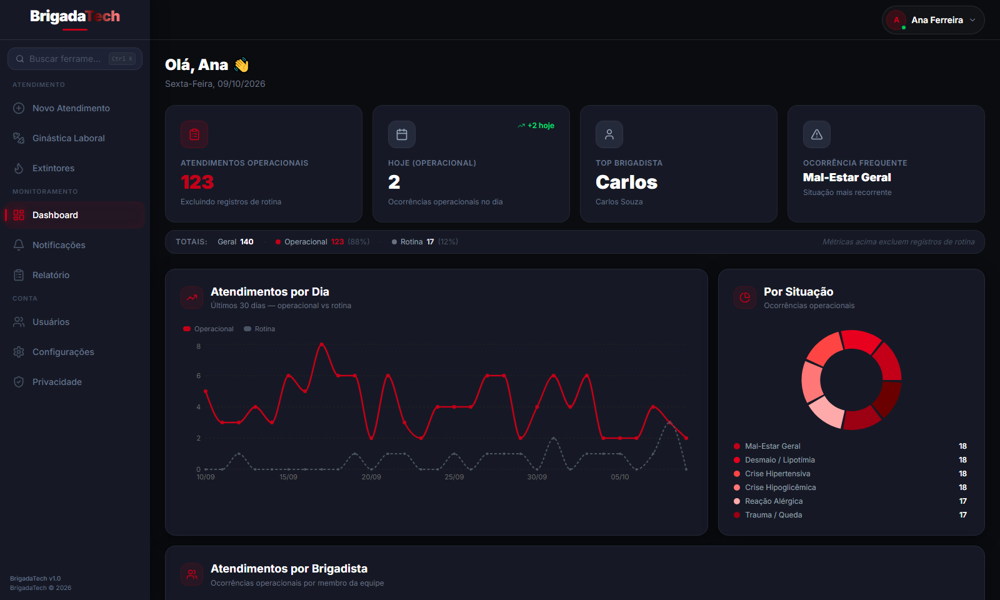

## Visão Geral

Sistema web fullstack para registro, gestão e análise de atendimentos da brigada — **BrigadaTech**. Desenvolvido com stack moderna e design corporativo premium.

**Stack:** React + TypeScript + TailwindCSS + Supabase + Recharts + Lucide React

---

## Telas

<table>
<tr>
<td align="center"><strong>Login</strong></td>
<td align="center"><strong>Dashboard (interno)</strong></td>
</tr>
<tr>
<td></td>
<td></td>
</tr>
</table>


### Passo  — Instalar e Rodar

```bash
# Instalar dependências
npm install

# Iniciar em desenvolvimento
npm run dev

# Build para produção
npm run build
```


### Deploy

Aplicação hospedada na **Vercel**, com backend/dados no **Supabase**. O deploy é automático a cada push para a branch principal — sem necessidade de Docker ou servidor próprio.

---

## Identidade Visual

| Elemento | Valor |
|---|---|
| Vermelho institucional | `#C40018` |
| Preto | `#0A0A0A` |
| Fundo cards | `#111111` |
| Bordas | `#242424` |
| Tema | Dark mode exclusivo |

---

## Tecnologias

- **React 18** + **TypeScript** — Frontend
- **Vite** — Build tool
- **TailwindCSS** — Estilização
- **Supabase** — Backend (Auth + PostgreSQL + RLS)
- **Recharts** — Gráficos
- **Lucide React** — Ícones
- **date-fns** — Manipulação de datas
- **react-router-dom v6** — Roteamento

---

*BrigadaTech — Sistema Interno Corporativo © 2025*
